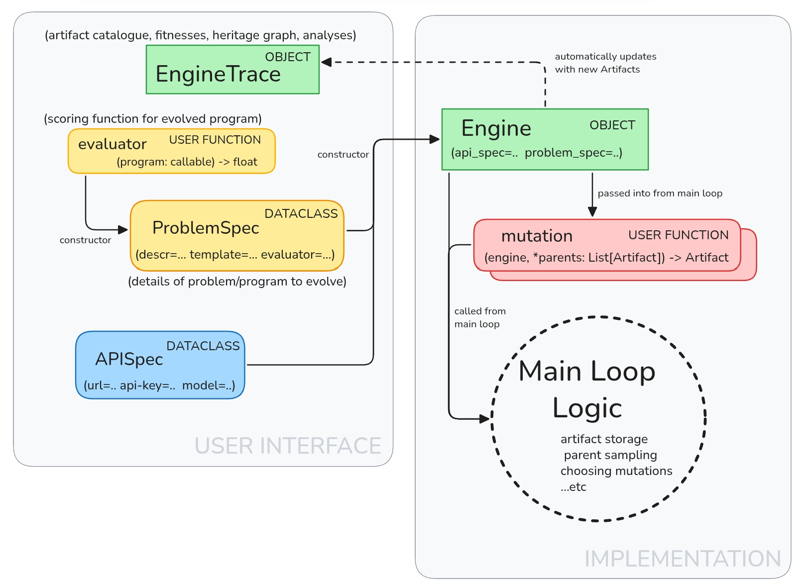
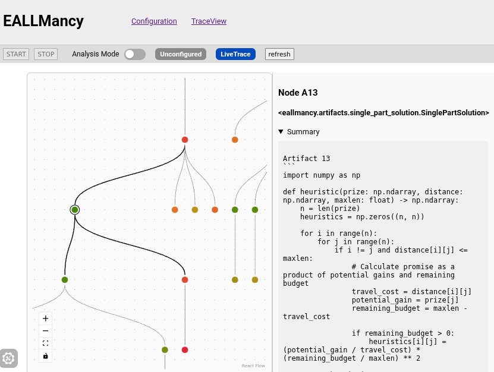
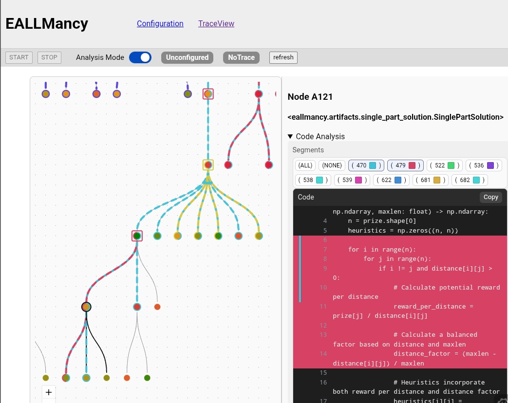

# eaLLMancy

**A practical framework for code generation using Evolutionary Algorithms + Large Language Models (EALLMs).**

Developed for my MSc dissertation — *"eaLLMancy: Practical Frameworks for Code Generation using Evolutionary Algorithms and Large Language Models"* — Department of Computing, Imperial College London, 2025.

## Overview

Recent years have produced a wave of evolutionary algorithms that use LLMs as a black-box mutation operator — FunSearch, EoH, ReEvo, and most recently AlphaEvolve. These methods share a common skeleton (candidate database, fitness evaluation, fitness-weighted sampling, LLM-driven mutation), yet almost no code is shared between research implementations.

**eaLLMancy** distils that skeleton into a small set of clean abstractions (`ProblemSpec`, `Engine`, `Artifact`, `EngineTrace`) that remove the boilerplate of solution tracking, evaluation, and API handling:

Key results from the dissertation:

- **~4× reduction in lines of code** when re-implementing state-of-the-art EALLM algorithms (FunSearch, EoH, ReEvo) on top of the framework — see [`algorithms/`](algorithms/) vs. the original reference implementations in [`algorithms/benchmark/`](algorithms/benchmark/).
- **A built-in web GUI** for monitoring live EALLM runs: heritage-graph visualisation, per-node code inspection, and run configuration — provided "for free" by the framework's trace abstraction.
- **Novel interpretability methods** using open-source plagiarism-detection tooling ([JPlag](https://github.com/jplag/JPlag)) to measure code similarity between evolved programs, characterise population diversity, and identify *heritable code snippets* that propagate through the evolutionary run.

### Live trace GUI

Watch an evolutionary run unfold: each node is a candidate program, edges show parentage, colour shows fitness.

### Integrated segment analysis

Analysis mode overlays plagiarism-detection results onto the heritage graph — highlighted segments are code snippets inherited across generations:

## Repository layout

| Path | Contents |
|------|----------|
| `eallmancy/` | The core framework: engine, artifacts, evaluation workers, and trace analysis (JPlag integration, segmentation, clustering) |
| `eallmancy_gui/` | Web GUI — FastAPI/WebSocket backend + React frontend |
| `algorithms/` | FunSearch, EoH, and ReEvo re-implemented on the framework; `benchmark/` holds the reference versions used for comparison |
| `problems/` | Benchmark problem specs and converters to/from the [LLM4AD](https://github.com/Optima-CityU/llm4ad) and [ReEvo](https://github.com/ai4co/reevo) ecosystems |
| `experiments/` | Notebooks and job scripts behind the dissertation's experiments (diversity, clustering, meta-analysis, JPlag studies) |
| `writeup/` | Dissertation sources (not tracked) |

## Setup notes

This is research code, archived roughly as it was at submission. To run it:

1. Create the environment: `./make_env.sh` (Python venv + `requirements.txt`).
2. Provide an OpenAI-compatible API key via the `OPENAI_API_KEY` environment variable.
3. The top-level `llm4ad` and `reevo` symlinks point to locally modified checkouts of [LLM4AD](https://github.com/Optima-CityU/llm4ad) and [ReEvo](https://github.com/ai4co/reevo), expected as sibling directories (`../llm4ad_mod`, `../reevo_mod`). They are only needed for the benchmark comparisons in `problems/` and `algorithms/benchmark/`.
4. The plagiarism-detection analysis requires the [JPlag](https://github.com/jplag/JPlag/releases) jar (not tracked due to size) placed at `experiments/jplag/jplag.jar`.
5. The GUI frontend builds with `npm run build` in `eallmancy_gui/frontend/`; the backend is served from a notebook or script via `eallmancy_gui/gui_handler.py`.
